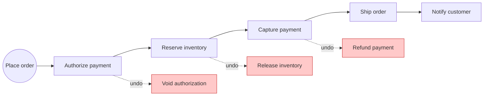
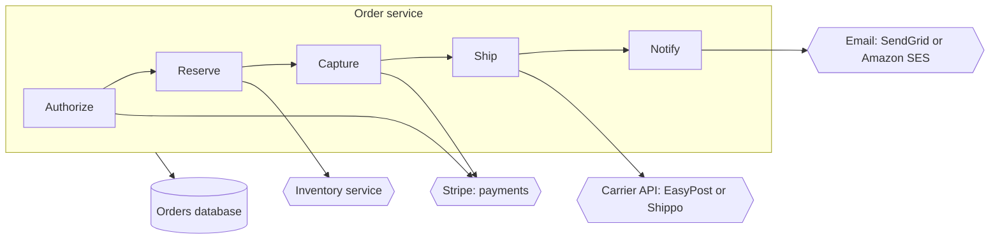
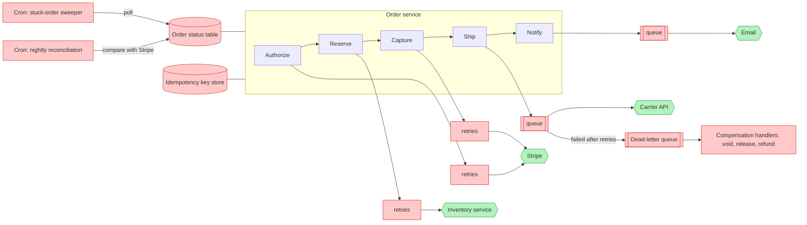
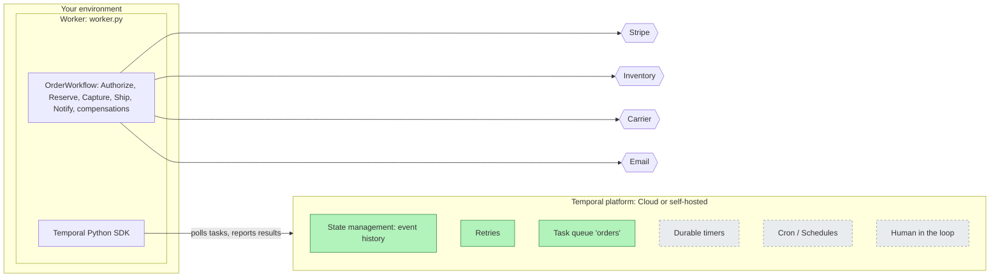

# Order workflow on Temporal

An e-commerce order as one durable Temporal workflow (Python):
authorize -> reserve inventory -> capture -> ship -> notify,
with a saga that undoes completed steps if a later one fails.

## Run it

```bash
pip install -r requirements.txt
temporal server start-dev     # terminal 1, Web UI http://localhost:8233
python worker.py              # terminal 2
python client.py 1            # terminal 3
```

## Demo scenarios

| # | Scenario | Command | What you should see |
| --- | --- | --- | --- |
| 1 | Happy path | `python client.py 1` | `COMPLETED, tracking track-1`, with all 4 steps and an email in the worker log |
| 2 | Flaky gateway | `python client.py 2 gateway_flaky` | Authorize attempts 1 and 2 fail, attempt 3 succeeds, then COMPLETED |
| 3 | Card declined | `python client.py 3 card_declined` | 1 attempt only, no undo, `FAILED: Card declined` |
| 4 | Out of stock | `python client.py 4 out_of_stock` | `voided auth-4`, then FAILED |
| 5 | Bad address | `python client.py 5 bad_address` | `refunded charge-5`, then `released res-5`, then FAILED |
| 6 | Worker crash | `python client.py 6 slow_inventory`, kill the worker during the 10 s wait (`pkill -9 -f worker.py`), restart it | Reserve retries within about 15 s and the order completes. Authorize is not re-run. |
| 7 | Duplicate order | `python client.py 1` again | `WorkflowAlreadyStartedError`: the same order cannot run twice |

While order 6 runs, check its status:
`temporal workflow query --workflow-id order-6 --name get_status`

## Design

### 1. Business process



If a step fails, every completed step is undone, newest first:

| Step that fails | Undo run, in this order | Order ends as |
| --- | --- | --- |
| Authorize | nothing | FAILED |
| Reserve inventory | Void authorization | FAILED |
| Capture payment | Release inventory, Void authorization | FAILED |
| Ship order | Refund payment, Release inventory | FAILED |
| Notify customer | nothing, failure is logged | COMPLETED |

Transient failures (a gateway timeout) are retried with backoff. Business failures
(card declined, out of stock, bad address) are not retried: the order compensates.

## Before and after Temporal

### 2. External services: the happy path



On the happy path, the order calls 4 external systems: Stripe for payments, an inventory
service, a carrier API and an email provider. Every one of these calls can time out,
return an error or rate-limit.

### 3. Making it resilient by hand



Red = resiliency logic you build and run. Green = the external services the business logic calls.

Without Temporal, the 5 business steps need about 8 extra components to survive failures:
retries, queues, a DLQ, compensation handlers, a status table, an idempotency store and
two cron jobs. That resiliency logic is spread across services and is most of the code.

### 4. Durable execution with Temporal



Green = platform features this solution uses. Grey dashed = possible enhancements.

With Temporal, the order is one workflow function. The red components move into the platform:

| Hand-built (diagram 3) | With Temporal | In the code |
| --- | --- | --- |
| Order status table | Event history, plus a query for the current step | `get_status` |
| Retry and backoff wrappers | Retry policy per activity, run by the server | `STEP_RETRY`, `UNDO_RETRY` |
| Queues to carrier and email | Task queue that workers poll | `TASK_QUEUE = "orders"` |
| Dead-letter queue | Non-retryable errors trigger the undo; stuck work shows in the Web UI | `non_retryable=True` |
| Compensation handlers | One list in one place, run newest first | `compensations` |
| Stuck-order cron | Per-attempt timeout, then a retry on any worker | `STEP_TIMEOUT` |

Still my job: idempotency at Stripe (send a key such as `{order_id}-capture`) and
reconciliation as a safety check.

## Who benefits, and how

| Persona | Pain today | What's in it for them | Where this repo shows it |
| --- | --- | --- | --- |
| CTO / VP Engineering | Checkout is the revenue path, and its resiliency code costs more to build and run than the features | Teams ship business logic instead of plumbing; one platform for orders, refunds and payouts | Diagram 3 vs diagram 4: about 8 hand-built components move into the platform |
| Developers | Retry loops, status tables and undo handlers in every service; failure paths are hard to test | The order is one readable function; retries and timeouts are config; time-skipping tests run in seconds | `workflow.py`, `tests/test_workflow.py` |
| SRE / on-call | Paged for stuck orders, DLQs to drain, risky restarts | Kill or redeploy workers at any time; every order's history is in the Web UI | Demo scenario 6 (worker crash) |
| Payments and finance ops | Double charges, card holds left behind, reconciliation finds problems the next day | Every completed step is undone on failure; an order ID cannot run twice | Failure table under diagram 1, `REJECT_DUPLICATE` |
| Customer support | "Where is my order?" means asking engineering | The current step is one query away | `get_status` |
| Product manager | Adding a step (fraud check, cancel window, delivery wait) is a multi-team project | A new step is a new activity call or signal in one function | Possible enhancements |

## How I approached this
- **Why this use case:** I work with many e-commerce businesses that integrate Stripe.
  I asked what happens in their business after the API call that accepts a payment:
  card holds, inventory, shipping, and refunds when something breaks.
- **Made failures easy to show:** a small command-line client (`client.py`) triggers each scenario
  (failed payment, flaky gateway, no inventory, bad address, worker crash).Which was helpful in building the project incrementally.
- **Considered but kept out:** see Possible enhancements. Worth knowing, but not needed
  to show the core idea.

## Possible enhancements

| Enhancement | Why | Temporal docs |
| --- | --- | --- |
| Heartbeats on slow activities | Notice a dead worker in seconds, not after the 15 s timeout | [Activity heartbeats and timeouts](https://docs.temporal.io/develop/python/activities/timeouts), [Detecting activity failures](https://docs.temporal.io/encyclopedia/detecting-activity-failures) |
| Signals for delivery confirmation and a dispute window | Human in the loop: wait for the carrier or the buyer, with a durable timer | [Signals, Queries and Updates](https://docs.temporal.io/develop/python/workflows/message-passing) |
| An Update with a validator to cancel before shipping | The customer gets an immediate accept or reject | [Update handlers and validators](https://docs.temporal.io/develop/python/workflows/message-passing) |
| Idempotency keys sent to the payment gateway | A retried capture must never charge twice | [Activity idempotency](https://docs.temporal.io/activity-definition#idempotency) |
| A Schedule for daily reconciliation | Replaces a cron job; durable, pausable, visible in the UI | [Schedules](https://docs.temporal.io/develop/python/workflows/schedules) |
| Workflow versioning | Deploy code changes safely while orders are still running | [Versioning and patching](https://docs.temporal.io/develop/python/workflows/versioning) |