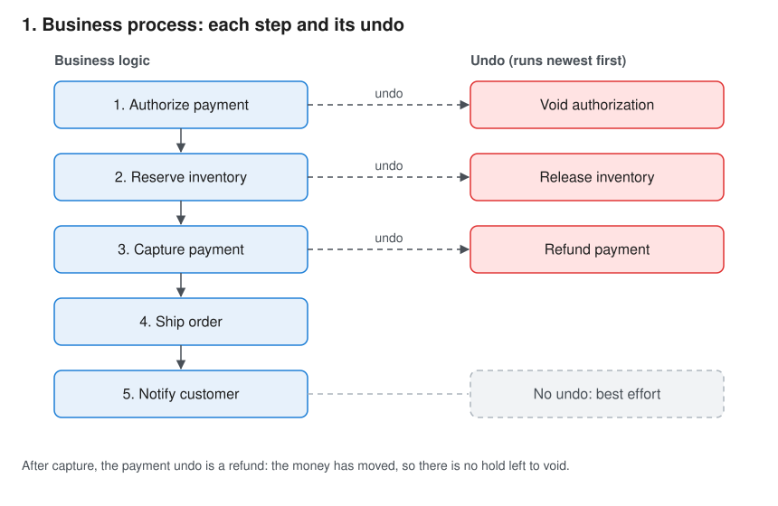
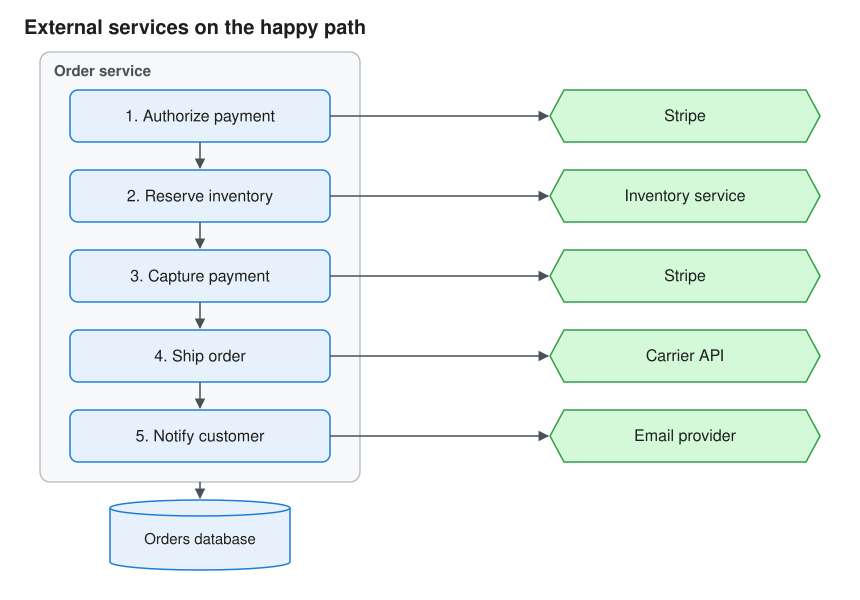
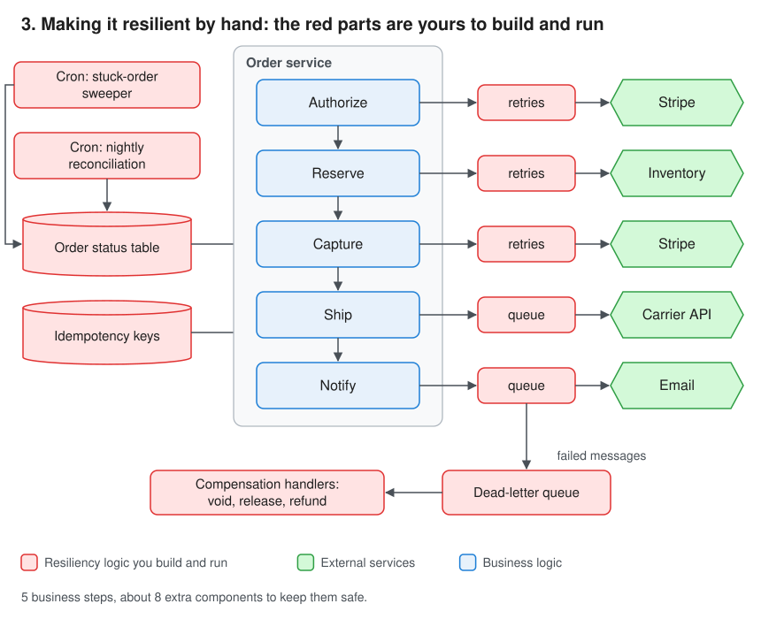
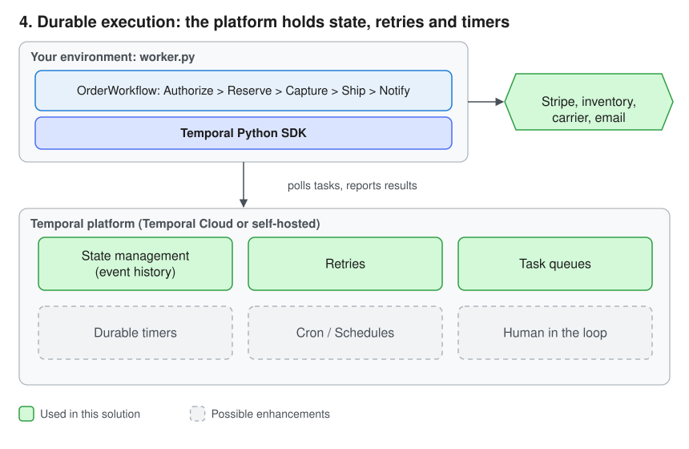

# Order workflow on Temporal

This repo implements an e-commerce order as one durable Temporal workflow in Python:
authorize payment, reserve inventory, capture payment, ship, notify. If a step fails, or the
order is cancelled before shipping, every step that started is undone. If an undo cannot
succeed, the order waits for a person to decide.

The sections below cover:

- **Installation and Run it:** set up Temporal and Python, then run the workflow locally.
- **Demo scenarios:** 11 scenarios, from the happy path to a worker crash, cancellations and
  a refused refund, triggered with `client.py` to show durable execution at work.
- **Design, and before and after Temporal:** the order's architecture with and without Temporal.
- **Who benefits:** what Temporal offers each persona involved.
- **How I approached this** and **Known limitations and next steps:** my reasoning, and what I left out.

## Installation

Tested on Python 3.12.5. You need 3 things: the Temporal CLI (which runs a local Temporal
server), a Python virtual environment, and the Python packages.

### 1. Install the Temporal CLI

| OS | Command |
| --- | --- |
| macOS | `brew install temporal` |
| Linux (or macOS without Homebrew) | `curl -sSf https://temporal.download/cli.sh \| sh` |
| Windows | `scoop install temporal-cli` |

Check it installed:

```bash
temporal --version
```

### 2. Start the local Temporal server

In its own terminal (terminal 1), and leave it running:

```bash
temporal server start-dev
```

This starts the Temporal server on `localhost:7233` and the Web UI at http://localhost:8233.
It keeps data in memory, so workflows are gone when you stop it. To keep them between restarts:

```bash
temporal server start-dev --db-filename temporal.db
```

### 3. Create a Python virtual environment

From the repo root:

```bash
python3.12 -m venv .venv
source .venv/bin/activate        # Windows: .venv\Scripts\activate
python --version                 # should print Python 3.12.x
```

Activate the environment in every terminal you use for the worker, the client or the tests.

### 4. Install the Python packages

```bash
pip install --upgrade pip
pip install -r requirements.txt
```

`requirements.txt` pins exact versions. The top-level packages are `temporalio` (the Temporal
Python SDK), `pytest` and `pytest-asyncio` (for the tests).

## Run it

| Terminal | Command | What it does |
| --- | --- | --- |
| 1 | `temporal server start-dev` | Local Temporal server and Web UI (step 2) |
| 2 | `python worker.py` | Runs the workflow and activity code |
| 3 | `python client.py 1` | Places order 1 and waits for the result |

Then open http://localhost:8233 to see order 1's event history.

Run the tests (no server needed, pytest starts its own):

```bash
pytest -v
```

## Demo scenarios

| # | Scenario | Command | What you should see |
| --- | --- | --- | --- |
| 1 | Happy path | `python client.py 1` | `COMPLETED, tracking track-1`, with all 4 steps and an email in the worker log |
| 2 | Flaky gateway | `python client.py 2 gateway_flaky` | Authorize attempts 1 and 2 fail (the worker logs a warning with a stack trace for each), attempt 3 succeeds, then COMPLETED |
| 3 | Card declined | `python client.py 3 card_declined` | 1 attempt only, then the void finds nothing to do (`no hold to void for order 3`), then `FAILED: Order failed: Card declined` |
| 4 | Out of stock | `python client.py 4 out_of_stock` | `no reservation to release for order 4`, `voided auth-4`, then FAILED |
| 5 | Bad address | `python client.py 5 bad_address` | `refunded charge-5`, then `released res-5`, then FAILED |
| 6 | Worker crash | `python client.py 6 slow_inventory`, kill the worker during the 10 s wait (`pkill -9 -f worker.py`), restart it | Reserve stops heartbeating, is retried after 5 s, and the order completes about 15 s after the kill. Authorize is not re-run. |
| 7 | Duplicate order | `python client.py 1` again | `Not started: order-1 already exists`: the same order cannot run twice |
| 8 | Customer cancels | `python client.py 8 slow_inventory`, then in another terminal during the wait: `python client.py cancel 8` | `Cancel accepted while RESERVING`. Reserve is stopped (no `reserved` line), `no reservation to release for order 8`, `voided auth-8`, `CANCELLED` |
| 9 | Operator cancels | `python client.py 9 slow_inventory`, then during the wait: `temporal workflow cancel --workflow-id order-9` | Same as 8. Status in the Web UI: Canceled |
| 10 | Cancel too late | `python client.py cancel 1` | `Rejected: workflow execution already completed`. While an order is shipping, the reply is `Rejected: Too late to cancel: order is SHIPPING` |
| 11 | Refund refused | `python client.py 11 refund_rejected`, then `python client.py status 11`, then `python client.py resolve 11 done_manually` | Ship fails and Stripe refuses the refund. The worker logs an `ERROR` and the order waits: status `NEEDS_ATTENTION: refund_payment failed`. After `resolve`, the remaining undo runs (`released res-11`), then FAILED |

While order 6 runs, check its status (either command):

```bash
python client.py status 6
temporal workflow query --workflow-id order-6 --name get_status
```

Each worker log line starts with the order and the step, for example
`[order-4 void_authorization attempt 1]`. The SDK's `activity.logger` attaches them.

## Design

### 1. Business process



If a step fails, the undo for every step that started is run, newest first. That includes
the step that failed: it may have taken effect before failing. An undo with nothing to undo
does nothing.

| Step that fails | Undo run, in this order | Order ends as |
| --- | --- | --- |
| Authorize | Void authorization | FAILED |
| Reserve inventory | Release inventory, Void authorization | FAILED |
| Capture payment | Refund payment, Release inventory, Void authorization | FAILED |
| Ship order | Refund payment, Release inventory | FAILED |
| Notify customer | nothing, failure is logged | COMPLETED |
| Customer or operator cancels (before shipping) | Same as a failure at the current step | CANCELLED |

**Why each undo is added before its step runs:** a step can take effect and still never report
back. A capture can charge the card and then lose its response. If the undo were only added
after a step reported success, that charge would never be undone. So every undo is added
first, and every undo is safe to run when there is nothing to undo.

**Activities are idempotent.** Temporal runs an activity at least once: a retry can repeat a
call that already took effect. Every call to a service sends an idempotency key,
`{order_id}-{step}` (such as `42-capture`), and the stand-in services in `fake_services.py`
behave like Stripe: a repeated key returns the first response and changes nothing.

**Activities heartbeat.** Each activity heartbeats in the background while it waits on a
service (`call_service` in `activities.py`), with a 5 s `heartbeat_timeout`. That is how
Temporal notices a dead worker in 5 s, and the only way a cancel reaches a running activity.

**Two ways to cancel, both stop the running step:**

- **Customer cancel** is an Update (`OrderWorkflow.cancel`). Its validator accepts it only before
  shipping, so the customer gets an immediate yes or no. Each step races the activity against
  the cancel (`start_activity` plus `wait_condition`) and cancels the activity when the Update
  lands. The order ends as FAILED with type `OrderCancelled`.
- **Operator cancel** (`temporal workflow cancel`) does the same and ends the workflow as Canceled.
- Each step waits for the activity to actually stop before the undo runs
  (`WAIT_CANCELLATION_COMPLETED`); otherwise it could finish its side effect after the undo. If a
  step finishes anyway, the workflow checks for the cancel before the next step
  (`workflow.cancellation_reason()`), so a cancel before shipping is never lost.
- **Once shipping has started, it is too late.** The customer cancel is rejected. An operator
  cancel does not interrupt the carrier booking; the order completes and the worker logs
  `Cancel ignored`.

**A cancel never stops an undo.** Undos run inside `asyncio.shield`, so an operator cancel during
compensation does not interrupt them, and the order ends with its original outcome.

**If an undo cannot succeed, a person decides.** An undo retries transient errors up to 10 times.
If it still fails, or the service rejects it (Stripe refuses a refund), the order moves to
`NEEDS_ATTENTION`, the worker logs an `ERROR`, and the workflow waits for an ops Update,
`resolve_undo`, with `retry` or `done_manually`. Its validator rejects anything else, and
rejects it when nothing is waiting.

Transient failures (a gateway timeout) are retried with backoff, for up to 2 minutes per step
(`STEP_DEADLINE`, a `schedule_to_close_timeout`). Business failures (card declined, out of stock,
bad address) are not retried: the order compensates. They are marked `BENIGN`, so the SDK does not
log a stack trace for an expected outcome; unexpected errors are still logged in full.

## Before and after Temporal

### 2. External services: the happy path



On the happy path, the order calls 4 external systems: Stripe for payments, an inventory
service, a carrier API and an email provider. Every one of these calls can time out,
return an error or rate-limit.

### 3. Making it resilient by hand



Without Temporal, the 5 business steps need about 8 extra components to survive failures:
retries, queues, a DLQ, compensation handlers, a status table, an idempotency store and
two cron jobs. That resiliency logic is spread across services and is most of the code.

### 4. Durable execution with Temporal



With Temporal, the order is one workflow function. 6 of the 8 red components move into the platform:

| Hand-built (diagram 3) | With Temporal | In the code |
| --- | --- | --- |
| Order status table | Event history, plus a query for the current step | `get_status` |
| Retry and backoff wrappers | Retry policy per activity, run by the server | `STEP_RETRY`, `UNDO_RETRY` |
| Queues to carrier and email | Task queue that workers poll | `TASK_QUEUE = "orders"` |
| Dead-letter queue | Non-retryable errors trigger the undo; an undo that cannot succeed waits for ops in the workflow itself | `non_retryable=True`, `NEEDS_ATTENTION`, `resolve_undo` |
| Compensation handlers | One list in one place, run newest first | `compensations` |
| Stuck-order cron | Heartbeat and per-attempt timeouts, then a retry on any worker; an overall deadline per step | `HEARTBEAT_TIMEOUT`, `STEP_TIMEOUT`, `STEP_DEADLINE` |

The other 2 stay outside the platform:

- **Idempotency keys stay yours.** Temporal runs activities at least once, so it does not replace
  idempotency at Stripe. Each call sends a key per step, such as `42-auth` or `42-capture`, so a
  retried call never creates a duplicate payment (see `activities.py`).
- **Reconciliation becomes a Schedule** (see Known limitations and next steps). It stays as a safety check,
  not as the way failed orders are recovered.

**Why a step can give up safely:** when a step hits its 2-minute deadline, its side effect may
still have happened, for example a capture that went through but whose response was lost. That
is safe here because the step's undo was added before it ran and every undo is idempotent: the
refund runs, and refunds only if there is a charge.

## Who benefits, and how

| Persona | Pain today | What's in it for them | Where this repo shows it |
| --- | --- | --- | --- |
| CTO / VP Engineering | Checkout is the revenue path, and its resiliency code costs more to build and run than the features | Teams ship business logic instead of plumbing; one platform for orders, refunds and payouts | Diagram 3 vs diagram 4: 6 of 8 hand-built components move into the platform |
| Developers | Retry loops, status tables and undo handlers in every service; failure paths are hard to test | The order is one readable function; retries and timeouts are config; time-skipping tests run in seconds | `workflow.py`, `tests/test_workflow.py` |
| SRE / on-call | Paged for stuck orders, DLQs to drain, risky restarts | Kill or restart workers at any time; every order's history is in the Web UI; a failed undo waits for a decision instead of retrying forever | Demo scenarios 6 and 11 |
| Payments and finance ops | Double charges, card holds left behind, reconciliation finds problems the next day | Every step that started is undone on failure or cancel; idempotency keys on every call; an order ID cannot run twice; a refused refund is handed to a person | Failure table under diagram 1, `activities.py`, `REJECT_DUPLICATE`, demo scenario 11 |
| Customer support | "Where is my order?" and "please cancel" mean asking engineering | The current step is one query away; a cancel is one Update, accepted or rejected at once | `get_status`, `cancel`, demo scenarios 8–10 |
| Product manager | Adding a step (fraud check, cancel window, delivery wait) is a multi-team project | A new step is a new activity call or signal in one function | Known limitations and next steps |

## How I approached this
- **Why this use case:** I work with many e-commerce businesses that integrate Stripe.
  I asked what happens in their business after the API call that accepts a payment:
  card holds, inventory, shipping, and refunds when something breaks.
- **Made failures easy to show:** a small command-line client (`client.py`) triggers each scenario
  (failed payment, flaky gateway, no inventory, bad address, worker crash, cancellations, a refused
  refund). It also let me
  build and test the workflow one step at a time.
- **Considered but kept out:** see Known limitations and next steps. Worth knowing, but not needed
  to show the core idea.

## Known limitations and next steps

The goal was to show the core idea. So these are some of deliberate gaps,
each with the Temporal feature that should close it.

| Gap today | Why it matters | Next step | Temporal docs |
| --- | --- | --- | --- |
| `NEEDS_ATTENTION` only logs an `ERROR` | Nobody is paged; ops must watch the logs | An alert activity (PagerDuty, Slack) before waiting for ops | [Signals, Queries and Updates](https://docs.temporal.io/develop/python/workflows/message-passing) |
| Order status is a query, not a search attribute | Ops cannot list "all orders in NEEDS_ATTENTION" in the Web UI | Upsert an `OrderStatus` search attribute. Not done here: the time-skipping test server does not support custom search attributes, so the tests would need the dev server | [Search attributes](https://docs.temporal.io/develop/python/observability) |
| The stand-in services keep state in the worker's memory | Killing the worker forgets holds and charges; a real Stripe keeps them | Call real sandboxes (Stripe test mode) | [Activity idempotency](https://docs.temporal.io/activity-definition#idempotency) |
| Customer email stored in plain text in the event history | Visible to anyone with Web UI access | Encrypt payloads with a payload codec and codec server | [Payload encryption](https://docs.temporal.io/develop/python/data-handling/data-encryption) |
| No workflow versioning | Changing `workflow.py` while orders are running breaks their replay | `workflow.patched()` for code changes, or Worker Versioning | [Versioning](https://docs.temporal.io/develop/python/workflows/versioning) |

Also next: delivery and dispute signals with a durable timer, a reconciliation Schedule,
and a Temporal Cloud connection.

A failed order's ID cannot be reused (`REJECT_DUPLICATE`). That is deliberate: it prevents a
double charge, and the customer places a new order instead.