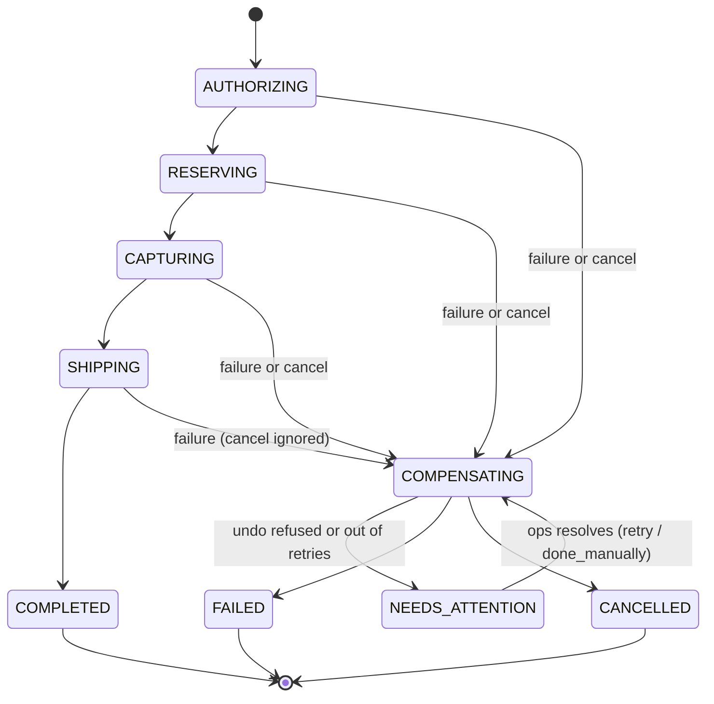

# Order workflow on Temporal

An e-commerce order modelled as a single Temporal workflow:

authorize payment → reserve stock → capture payment → ship → notify customer

If a step fails, or the customer cancels before shipping, the completed steps are undone in
reverse order. If an undo cannot complete (for example, Stripe refuses a refund), the order
pauses until an operator decides what to do.

Submission for the Temporal SA technical exercise, e-commerce order use case. Built with the
Temporal Python SDK. Stripe, inventory, the carrier and email are mocked in `fake_services.py`.

Quick start (full setup in [section 6](#6-run-the-demo)):

```bash
temporal server start-dev          # terminal 1, Web UI at http://localhost:8233
python worker.py                   # terminal 2
python client.py 1                 # terminal 3 → COMPLETED, tracking track-1
```

## 1. The problem


The order depends on four external systems: Stripe, inventory, the carrier and email. Any of
them can time out, return an error or rate-limit.


Handling those failures without a workflow engine means building and running extra
infrastructure around five business steps: retry wrappers, queues, a dead-letter queue,
compensation handlers, an order status table, an idempotency store and cron jobs to find stuck
orders. That logic ends up spread across services and is hard to test.

## 2. The solution


With Temporal, the order is one workflow function. The platform records every step, so a
crashed worker resumes where it stopped instead of starting over.

| Built by hand | Provided by Temporal |
| --- | --- |
| Order status table | Event history, plus a `get_status` query |
| Retry and backoff code | Retry policy per activity |
| Queues to downstream systems | Task queue polled by workers |
| Dead-letter queue and stuck-order cron | Failed steps trigger compensation; a stuck undo waits for ops |
| Compensation handlers in each service | One compensation list in the workflow |
| Worker health checks | Heartbeat timeouts, then retry on another worker |

Still the application's responsibility:

- Idempotency keys on external APIs. Temporal runs activities at least once, so a retried
  call must not charge twice.
- A reconciliation job as a safety net. It is not the primary recovery path.

## 3. How the order works


Each step has a matching undo. On failure or cancel, the undos run newest first.

| Step that fails | Undos that run | Final result |
| --- | --- | --- |
| Authorize | None (the void runs and finds no hold) | FAILED |
| Reserve stock | Release stock, void hold | FAILED |
| Capture payment | Refund (if anything was captured), release stock, void hold | FAILED |
| Ship | Refund, release stock | FAILED |
| Notify | None (notification is best effort) | COMPLETED |
| Customer cancels before shipping | Same as a failure at the current step | CANCELLED |

Order states, including cancel and the ops hand-off:



## 4. Distributed systems challenges and how they are handled

| Challenge | Handling | Temporal feature / code | Demo |
| --- | --- | --- | --- |
| A call succeeds but the response is lost | Each undo is registered before its step runs; every undo is safe to run when there is nothing to undo | `compensations.append(...)` before each `step()` | 3 |
| A retry repeats a call that already took effect | Idempotency key on every external call, e.g. `{order_id}-capture` | Activities run at least once; keys checked in `fake_services.py` | 2 |
| Downstream service is flaky | Exponential backoff, 15 s per attempt, 2 min total, then compensate | `RetryPolicy`, `start_to_close_timeout`, `schedule_to_close_timeout` | 2 |
| Failure that retrying cannot fix (declined card, no stock) | Fail immediately and compensate | `ApplicationError(non_retryable=True)` | 3, 4 |
| Worker crashes mid-order | Another worker replays history and resumes; completed steps are not repeated | Event history replay, `heartbeat_timeout=5s` | 6 |
| Cancel arrives while a step is running | Stop the step, wait until it has actually stopped, then undo | Heartbeats deliver the cancel; `ActivityCancellationType.WAIT_CANCELLATION_COMPLETED` | 8, 9 |
| Cancel after the point of no return | Rejected once shipping starts | Update validator on `cancel` | 10 |
| Cancel arrives during cleanup | Undos always run to completion | Undo activities awaited inside `asyncio.shield` | 9 |
| An undo can never succeed (refund refused) | Pause in `NEEDS_ATTENTION` until ops chooses `retry` or `done_manually` | `resolve_undo` update, `wait_condition` | 11 |
| The same order is submitted twice | Second submission rejected | Workflow ID = order ID, `WorkflowIDReusePolicy.REJECT_DUPLICATE` | 7 |

There are two ways to cancel:

- Customer cancel (`python client.py cancel ID`) is a workflow update. The customer gets an
  immediate accept or reject, and the order ends as CANCELLED.
- Operator cancel (`temporal workflow cancel`) runs the same cleanup. The workflow ends with
  Temporal status Canceled.

## 5. Approach

- Use case: the e-commerce order from the exercise brief. <!-- TODO: one sentence on why you picked it, e.g. link to your Stripe payments experience -->
- Scope: payment authorize/capture, inventory, shipping and notification after an order is
  placed. Basket, pricing and checkout UI are out of scope.
- Mocks: external services are in-memory stand-ins that honour idempotency keys and
  treat an undo with nothing to undo as a success, so failure behaviour is realistic
  without live integrations.
- Process: built the happy path first, then added one failure scenario at a time (the
  `SIMULATE` options). The first version handled cancel with hand-written checks; it was
  then reworked to use Temporal primitives (updates with validators, activity cancellation
  types, `schedule_to_close_timeout`, ID reuse policy).
- Tests: 29 tests in `tests/` using the Temporal test environment; no server needed.

## 6. Run the demo

Requirements: Python 3.12+ and the Temporal CLI.

| OS | Install the Temporal CLI |
| --- | --- |
| macOS | `brew install temporal` |
| Linux | `curl -sSf https://temporal.download/cli.sh \| sh` |
| Windows | `scoop install temporal-cli` |

```bash
# Once, from the repo root
python3.12 -m venv .venv
source .venv/bin/activate          # Windows: .venv\Scripts\activate
pip install -r requirements.txt

# Terminal 1: local Temporal server (Web UI at http://localhost:8233)
temporal server start-dev

# Terminal 2 (activate the venv first)
python worker.py

# Terminal 3 (activate the venv first)
python client.py 1                 # → COMPLETED, tracking track-1
```

Run the tests without a server: `pytest -v`

### Client commands

```bash
python client.py ORDER_ID [SIMULATE]                    # place an order
python client.py cancel ORDER_ID                        # customer cancel
python client.py status ORDER_ID                        # current state
python client.py resolve ORDER_ID retry|done_manually   # ops decision on a stuck undo
```

Each order ID can only be used once. `SIMULATE` values: `card_declined`, `gateway_flaky`,
`out_of_stock`, `slow_inventory`, `bad_address`, `refund_rejected`.

### Scenarios

Use a new order ID for each run.

| # | Scenario | Command | Expected result |
| --- | --- | --- | --- |
| 1 | Happy path | `python client.py 1` | `COMPLETED, tracking track-1` |
| 2 | Transient payment error | `python client.py 2 gateway_flaky` | Authorize fails twice, then succeeds; COMPLETED |
| 3 | Card declined | `python client.py 3 card_declined` | Fails immediately; FAILED |
| 4 | Out of stock | `python client.py 4 out_of_stock` | Hold voided; FAILED |
| 5 | Bad shipping address | `python client.py 5 bad_address` | Refunded, stock released; FAILED |
| 6 | Worker crash | `python client.py 6 slow_inventory`, then `pkill -9 -f worker.py` and restart the worker | Reserve retried, authorize not repeated; COMPLETED |
| 7 | Duplicate order | `python client.py 1` again | Rejected: order ID already exists |
| 8 | Customer cancel | `python client.py 8 slow_inventory`, then `python client.py cancel 8` | Stock released, hold voided; CANCELLED |
| 9 | Operator cancel | As 8, but `temporal workflow cancel --workflow-id order-9` | Same cleanup; UI shows Canceled |
| 10 | Cancel too late | `python client.py cancel 1` | Rejected: order already finished |
| 11 | Refund refused | `python client.py 11 refund_rejected`, then `status 11`, then `resolve 11 done_manually` | Ship fails, refund refused, status NEEDS_ATTENTION. After resolve, stock released; FAILED: Bad address |

For scenarios 6, 8 and 9, act while the worker log shows the warehouse is slow, before
`reserved` appears.

## 7. Limitations and next steps

This is a demo, not production code. Known gaps:

| Limitation | Impact | Next step |
| --- | --- | --- |
| A stuck undo only writes a log line | Nobody is alerted | Send an alert (Slack, PagerDuty) on `NEEDS_ATTENTION` |
| Status is per order only | Ops needs the order ID to find stuck orders | Search attribute on status to list all `NEEDS_ATTENTION` orders |
| Simulated Stripe state lives in worker memory | Restarting the worker loses demo charges | Use Stripe test mode |
| Customer email is stored in plain text in history | Visible to anyone with UI access | Payload encryption codec |
| No workflow versioning | Changing the code can break in-flight orders on replay | `workflow.patched()` or worker versioning |

Further extensions: durable timers for delivery and dispute windows, a scheduled
reconciliation job, and Temporal Cloud for a shared environment.